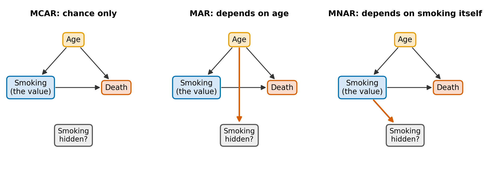
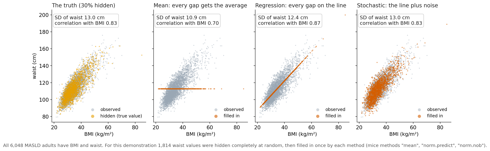
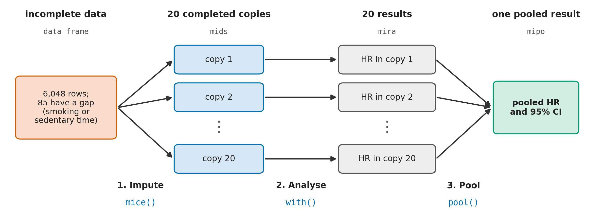
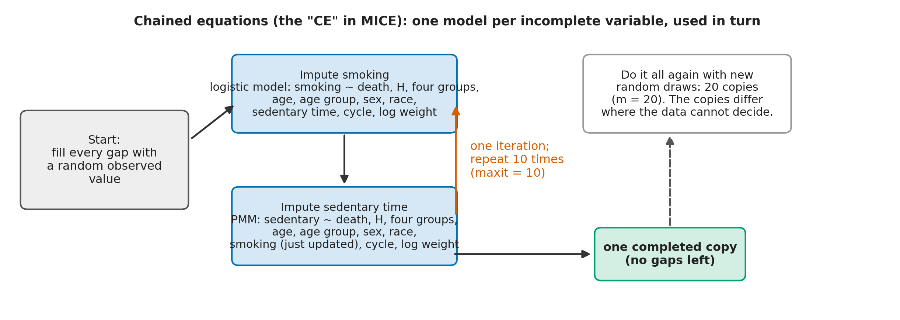
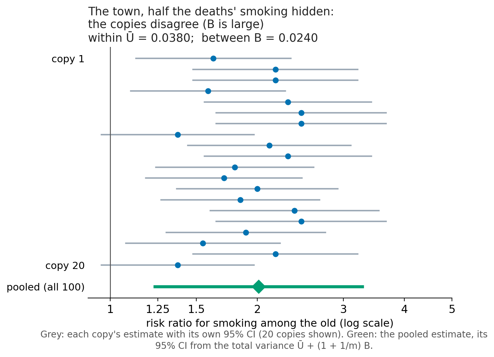
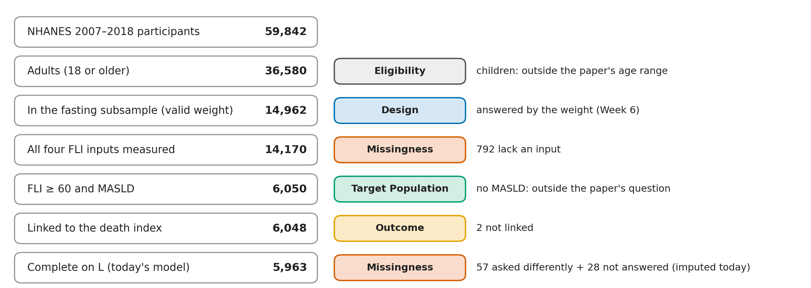
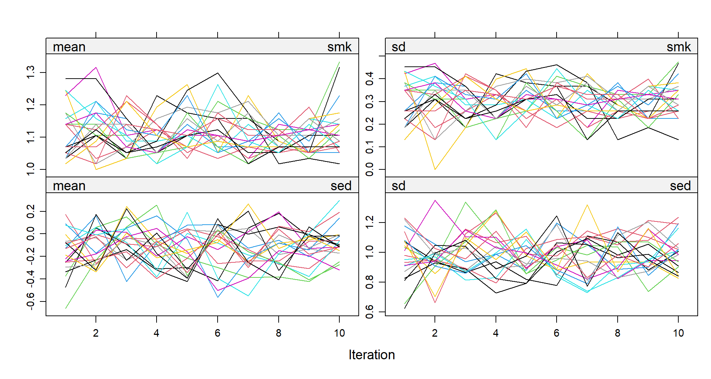
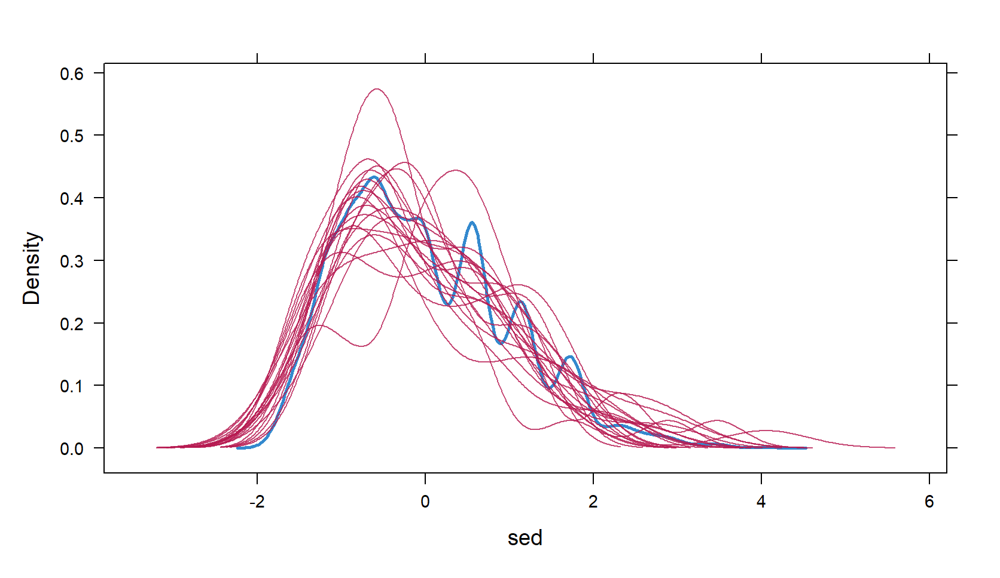
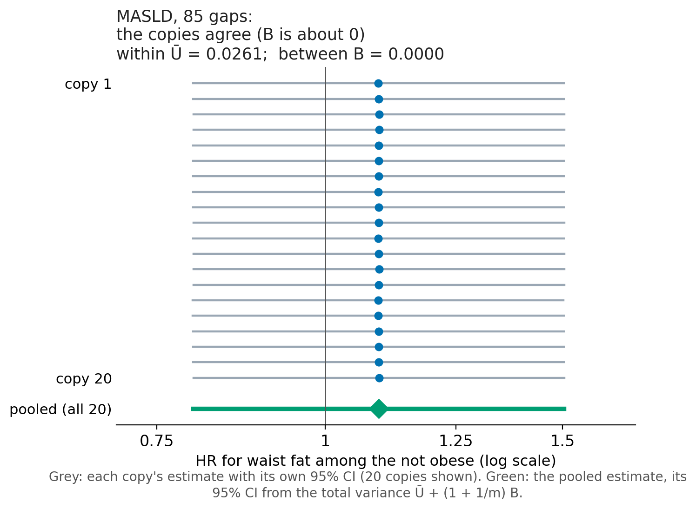

## Where Week 6 left us

High vs lower waist fat **among the non-obese** (Group IV vs III), adjusted for L:

| Analysis | HR (95% CI) |
|---|---:|
| Ordinary Cox model (week 4-5) | **1.09 (0.79-1.50)** |
| NHANES design-based Cox model (week 6) | **1.43 (0.98-2.07)** |

## R drops incomplete rows without asking

<!-- code: cc_default -->
```r
fm <- Surv(time_yr, dead) ~ obese * central + age + female + race + smk_current + sed
fit <- coxph(fm, data = dom)          # Week 5's model, given all 6,048 rows
c(rows_used = fit$n, deaths = fit$nevent, rows_dropped = length(fit$na.action))
#>    rows_used       deaths rows_dropped
#>         5963          534           85
```


::: {.remember}
A Cox model (like `glm()` and `svycoxph()`) silently keeps only the **complete cases**: rows with no blank in any model variable. That is a missing-data decision, made by the software's default.
:::

Week 6 ended with a warning:

::: {.warning}
**Complete cases are another domain, but that does not fix missing-data bias.**
:::

## This week (week 7)

**5,963** of the **6,048** MASLD adults with a fasting weight. Who was left out?

| On L | Complete: 5,963 | Incomplete: 85 |
|---|---:|---:|
| Mean age (years) | 51.1 | 32.0 |
| Died during follow-up | 9.0% (534) | 3.5% (3) |

::: {.question}
**Today's two questions.** 

- Did leaving them out change **who** our estimates describe? 
- Did it **bias** Weeks 4-6's hazard ratios?
:::

::: {.notes}
Start from Week 6's last warning. Nobody decided to drop the 85; they had a blank somewhere. Today is about what a blank can do to an estimate, and what we can do about it.
:::


## The workflow for today {.shrink}

::: {.workflow}
**0. Look -> 1. Set up -> 2. Impute and check -> 3. Analyse -> 4. Pool -> 5. Design -> Report both**
:::

| Step | What you do |
|--|----|
| <span class="step">0. Look</span> | type every loss, count the gaps, see the pattern, ask why, judge whether complete cases are fine |
| <span class="step">1. Set up</span> | choose what goes into the imputation model, and a method for each variable |
| <span class="step">2. Impute and check</span> | make m completed copies; check convergence and the filled-in values |
| <span class="step">3. Analyse</span> | fit the same model in every copy |
| <span class="step">4. Pool</span> | combine the m results with Rubin's rules |
| <span class="step">5. Design</span> | with NHANES: declare Week 6's design once per copy |

::: {.remember}
Software comes last. `mice()` cannot tell you **why** a value is missing, or whether imputing it is worth doing.
:::

# Part 1 - The ideas, in a made-up town

## Why missing data matter

Missing values can cause three problems:

1. **Bias.** If the people with missing values differ from the rest in ways that matter, the estimate can be wrong.
2. **Wrong precision.** A filled-in value treated as if it had been measured makes intervals too narrow.
3. **Lost power.** Dropping incomplete rows throws away the information those rows did carry.

::: {.remember}
- **How much** is missing mainly affects precision. 
- **Why** it is missing decides whether there is bias. 
- A small amount of missing data can still bias an estimate, and a large amount sometimes does not.
:::

## Three reasons a value can be missing

| Name (Rubin, 1976) | In plain words | Example: smoking status |
|---|---|---|
| **MCAR**: missing completely at random | pure chance | a page of the questionnaire was lost |
| **MAR**: missing at random | depends on things we **did** record | older people skip the question more often, and we know everyone's age |
| **MNAR**: missing not at random | depends on something we did **not** record: the missing value itself, or something related to it | smokers skip the question because they smoke |

::: {.question}
"Missing at random" does **not** mean random. It means random **once we account for what was observed**. Under MAR the observed data contain what we need to correct the problem; under MNAR they do not.
:::

## A town of 1,000, and its smokers

| | Smokers: died / all | Non-smokers: died / all | Risk ratio for smoking |
|---|---:|---:|---:|
| **Young** (600) | 12 / 120 (10%) | 24 / 480 (5%) | **2** |
| **Old** (400) | 80 / 200 (40%) | 40 / 200 (20%) | **2** |

- A **new** made-up town (not Week 6's), with a known truth: **32%** smoke (320 of 1,000).
- Smoking **doubles** the risk of death in each age group. 
- Age is a confounder: the old smoke more and die more.

::: {.remember}
Now suppose some people's smoking status is missing. But for different reasons.
:::

::: {.notes}
This is the truth we check every method against. Ask the class which question they think is easier to get right from incomplete data. Most will say the share.
:::


## Ways smoking goes missing

{fig-align="center" width="100%"}

The same population, but three different reasons why smoking status is missing:

- **MCAR:** Missing completely at random.
- **MAR:** Missingness depends on age.
- **MNAR:** Missingness depends on smoking itself.

**For each scenario, we ask:** Can we correctly estimate $p$ and $RR$?

::: {.notes}
We know the true smoking prevalence and risk ratios in this hypothetical town.

Now we deliberately hide smoking status in three different ways.

Our goal is to see whether analysing only complete cases gives the correct estimates.

The important question is whether the answer depends on what we are estimating.
:::


## Complete cases: estimating smoking prevalence {.fit80 .shrink}

The true smoking prevalence is **32% (320/1,000)**.

What happens when we exclude people with missing smoking status?

| Who is missing? | Smokers remaining | People remaining | Estimated prevalence |
|---|---:|---:|---:|
| No one (truth) | 320 | 1,000 | 32% |
| Half of everyone (MCAR) | 160 | 500 | 32% ✓ |
| Half of older adults (MAR) | 220 | 800 | 27.5% ✗ |
| Half of smokers (MNAR) | 160 | 840 | 19% ✗ |

**Why is the MAR estimate wrong?**

Older adults smoke more (50% vs. 20%). Removing half the older adults removes proportionately more smokers.

Only 220 smokers remain among 800 people: **220/800 = 27.5%**.

::: {.remember}
**Missingness can bias prevalence estimates when the remaining participants do not reflect the original population.**

The amount of missing data alone does not determine bias.
:::

::: {.notes}
The MAR example is worth explaining carefully.

All 600 younger adults remain, including 120 smokers.

Only half the 400 older adults remain, including 100 smokers.

That leaves 220 smokers among 800 people.

The estimate is too low because older adults, who smoke more frequently, are underrepresented.

Under MCAR, the proportion stays correct in this constructed example even though more people are excluded.

Under MNAR, fewer people are excluded, but smoking prevalence is substantially underestimated.
:::


## Same missing data, different conclusions {.fit80 .shrink}

Suppose smoking status is missing for **half the smokers (MNAR)**, regardless of whether they died.

We exclude everyone with missing smoking status (complete-case analysis).

**Does this bias our estimates? It depends on what we estimate.**

| What are we estimating? | True value | Complete cases | Biased? |
|---|---:|---:|---|
| **Proportion who smoke** (whole town) | 320 / 1,000 = 32% | 160 / 840 = 19% | Yes ✗ |
| **Risk ratio for smoking and death** (older adults) | (80 / 200) / (40 / 200) = 2.0 | (40 / 100) / (40 / 200) = 2.0 | No ✓ |

**Why the difference?**

- **Smoking prevalence:** We exclude half the smokers, so smokers are underrepresented.
- **Risk ratio:** We exclude equal proportions of smokers who died and survived, so the risk of death among smokers remains unchanged.

::: {.remember}
**Missing-data bias depends on what we are estimating.**

The same missingness mechanism can bias one estimate but not another.

**Always ask:** Does excluding people distort the quantity I want to estimate?
:::

::: {.notes}
We have the same population and the same missingness mechanism: smoking status is missing for half the smokers.

First, smoking prevalence.

Originally, 320 of 1,000 people smoked (32%).

After excluding half the smokers, we have 160 smokers among 840 people (19%).

Our prevalence estimate is biased because smokers were disproportionately excluded.

Now consider the risk ratio among older adults.

Originally, 80 of 200 smokers died (40%), compared with 40 of 200 non-smokers (20%). The risk ratio was 2.

After excluding half the smokers, 40 of 100 smokers died (40%). The risk among non-smokers remains 20%.

The risk ratio is therefore still 2.

The important distinction is that missingness was related to smoking but, within smoking and age groups, not to death.

The same missingness mechanism biased smoking prevalence but did not bias the age-specific risk ratio.

The lesson: Whether missing data cause bias depends on both why values are missing and what we are trying to estimate.
:::


## Can the data tell us which mechanism?

- **Against MCAR: sometimes.** Compare complete and incomplete rows on what you can see (age, sex, outcome). A clear difference rules out MCAR. Little's test (`naniar::mcar_test()`, next slide) does this formally.
- **For MCAR:** A non-significant test is not proof. These tests often have little power.
- **MAR versus MNAR: no test exists.** The values that would settle it are the missing ones.

::: {.remember}
Argue the mechanism from **how the data were collected**: who was asked, who answered, who was never asked, and why.
:::

[EpiMethods: [MCAR tests](https://ehsanx.github.io/EpiMethods/missingdata6.html).]{.foot}

## In R: Little's test on MCAR and MAR data

**Little's test** checks whether the observed data are consistent with missing completely at random (MCAR).

- **Null hypothesis:** Data are MCAR.
- **p < 0.05:** Evidence against MCAR.
- **p ≥ 0.05:** No evidence against MCAR (but not proof).

Let's create two examples where waist circumference is missing.

<!-- code: little_test -->
```r
library(naniar)
set.seed(604)
mcar_demo <- dom[, c("bmi", "waist")]                    # both complete
mcar_demo$waist[sample(nrow(mcar_demo), 1814)] <- NA    # hidden at random: MCAR
round(unlist(mcar_test(mcar_demo)), 3)
#>        statistic               df          p.value missing.patterns
#>            0.175            1.000            0.676            2.000
mar_demo <- dom[, c("bmi", "waist")]
mar_demo$waist[mar_demo$bmi > 35 & runif(nrow(mar_demo)) < 0.6] <- NA   # MAR
round(unlist(mcar_test(mar_demo)), 3)
#>        statistic               df          p.value missing.patterns
#>         1838.456            1.000            0.000            2.000
```

## In R: Little's test on MCAR and MAR data


| Scenario | p-value | Interpretation |
|---|---:|---|
| MCAR: waist values hidden randomly | 0.676 | No evidence against MCAR |
| MAR: waist more often missing at high BMI | < 0.001 | Evidence against MCAR |

**Why?** In the second example, people with missing waist values tend to have higher BMI. Missingness is therefore related to something we observed.

::: {.remember}
**Little's test can provide evidence against MCAR, but it cannot:**

- Prove that data are MCAR.
- Distinguish MAR from MNAR.
- Tell us whether complete-case analysis is biased.

**The test is one clue, not a diagnosis of the missingness mechanism.**
:::

::: {.notes}
We have learned about MCAR, MAR, and MNAR. But how can we tell which mechanism applies to our data?

Little's test provides one way to investigate whether the data are consistent with MCAR.

The idea is simple: compare people with missing values to those without missing values, using information we have observed.

Here, everyone has BMI and waist circumference measured initially.

In the first example, we randomly hide 1,814 waist measurements. Because the selection is random, people with missing waist measurements should have approximately the same BMI distribution as people whose waist measurements remain observed.

The p-value is 0.676. We do not reject MCAR. This does not prove that the missingness is completely random.

In the second example, we deliberately make waist circumference more likely to be missing among people with BMI above 35. About 60% of these individuals have their waist measurement hidden.

Now, people with missing waist measurements tend to have higher BMI than those with observed waist measurements.

The p-value is less than 0.001, providing strong evidence against MCAR.

We know this second example is MAR because we created the missingness using observed BMI. In real data, however, rejecting MCAR does not tell us whether the mechanism is MAR or MNAR.

There are two important limitations:

First, failure to reject MCAR does not establish that MCAR is true. The test may have limited power, and its assumptions matter.

Second, Little's test does not tell us whether our particular estimate is biased. As we saw in the smoking example, bias also depends on what we are estimating.

The main takeaway: Little's test can help us question MCAR, but understanding why data are missing still requires knowledge of how the data were collected.

The output also reports missing.patterns = 2, meaning there are two patterns: people with both BMI and waist observed, and people whose waist is missing.
:::

## Quick fixes that cause trouble

| Quick fix | What goes wrong |
|---|---|
| Complete cases without thinking (the default) | biased if missingness depends on the outcome; can change **who** the estimate describes |
| Fill every gap with the mean | shrinks the spread, weakens associations |
| Add a "missing" category or indicator | biased when the variable is a confounder (Vach & Blettner 1991; Greenland & Finkle 1995) |
| Carry the last value forward | assumes nothing changed |

::: {.warning}
Any **single** filled-in value is then treated as if it had been measured, so standard errors generally come out too small.
:::

::: {.notes}
Reviewers know these methods' reputation. If you use one, justify it. Next: what single filling-in does to a real relationship in our own data.
:::

## Single imputation: four ways to fill a gap

| Method | What fills each gap | In R (`mice` method) | Done once, what goes wrong |
|---|---|---|---|
| Mean | the observed mean | `"mean"`, or `mean(x, na.rm = TRUE)` | every gap the same: spread shrinks, links weaken |
| Regression prediction | the predicted value from the other variables | `"norm.predict"` | every gap on the line: links look too strong |
| Stochastic regression | the prediction plus a random residual | `"norm.nob"` | spread kept, but the line is treated as known |
| Predictive mean matching | a real observed value from a person with a close prediction | `"pmm"` | realistic values, but one copy still hides the uncertainty |

::: {.remember}
Any of these done **once** is single imputation: the analysis then treats the fills as measured. Multiple imputation makes several copies with proper random draws (`"pmm"`, `"norm"`, `"logreg"` also redraw the model's coefficients) and pools them.
:::

## Single imputation, in a picture

All 6,048 adults have BMI (x-axis) and waist (y-axis). We hid 1,814 waist values at random; in the first panel, gold marks their true values. Each other panel fills them once with one of the first three methods (orange = filled in, grey = observed); PMM comes back in Part 2.

{fig-align="center" width="100%"}

::: {.remember}
**Mean:** a flat orange line; SD of waist 10.9 vs 13.0 cm, correlation with BMI 0.70 vs 0.83. **Regression:** every fill on the line; correlation 0.87, too strong. **Stochastic:** spread and correlation about right here (13.0, 0.83), but one copy still hides the uncertainty.
:::

::: {.notes}
Real MASLD data: waist and BMI are complete for everyone, so we can hide 30% at random and compare each fill-in with the truth. Stochastic filling preserves spread and association only approximately, and only under a suitable model.
:::


## Multiple imputation in three steps

{fig-align="center" width="60%"}

| Step | In R | Object R prints | What it holds |
|------|----------------|------|------------------------|
| Impute | `imp <- mice(dat, m = 20)` | `mids` | the data, the m sets of filled-in values, the settings; `complete(imp, 1)` gives copy 1 as an ordinary data frame |
| Analyse | `fits <- with(imp, coxph(...))` | `mira` | one fitted model per copy |
| Pool | `pooled <- pool(fits)` | `mipo` | the combined estimates and their variances |

::: {.notes}
This is the picture to keep (Lumley 2010, ch. 9; van Buuren 2018). Impute m times, with random draws: the copies agree where the data are sure and differ where they are not. Analyse each copy with the same model. Pool the m results into one estimate and one interval. mids, mira and mipo are labels students will see in R, not terms to memorise.
:::


## How MICE works: one person, one iteration

Suppose a participant is missing **smoking status** and **sedentary time**.

MICE fills in each missing value using the other variables, then repeats the process.

| Step | Smoking | Sedentary time | What MICE does |
|--|-:|--:|------|
| Start | 0 | 300 min | Starts with temporary values for both missing variables |
| 1. Update smoking | **1** | 300 min | Uses sedentary time, age, etc. to predict smoking. Predicted probability = 20%; a random draw gives **smoker** |
| 2. Update sedentary time | 1 | **410 min** | Uses the updated smoking status, age, etc. to predict sedentary time. PMM selects an observed value (410 min) from someone with a similar prediction |
| Repeat | ... | ... | Updates both missing values again using the latest values |

**Why repeat?** Each imputed value helps predict the other, so the values are updated together.


## How MICE works: iterations (`maxit = 10`) vs. imputations (`m = 20`) {.fit85 .shrink}

MICE creates **multiple completed datasets**, and within each one, it repeatedly updates the missing values.

**Think of it this way:**

- **Imputation 1:** Start → Iteration 1 → ... → Iteration 10 → Completed dataset 1
- **Imputation 2:** Start → Iteration 1 → ... → Iteration 10 → Completed dataset 2
- ...
- **Imputation 20:** Start → Iteration 1 → ... → Iteration 10 → Completed dataset 20

Each iteration updates smoking, and sedentary time.

| | What happens? | Why? |
|--|-----|----|
| **`maxit = 10`** | Within each imputation, update all missing variables 10 times | Allow the imputation process to stabilize |
| **`m = 20`** | Run 20 separate imputation chains, each with 10 iterations | Reflect uncertainty about the missing values |

::: {.remember}
We then analyse all 20 datasets separately and combine the estimates using **Rubin's rules**.
:::

::: {.notes}
The distinction between m and maxit is important.

Think back to the previous slide, where we updated smoking and then sedentary time.

That was one iteration: we went through each incomplete variable once.

With maxit = 10, we repeat that updating process 10 times, using the latest values at every step.

After the tenth iteration, we keep the final imputed values. This produces one completed dataset.

But we do not stop there.

With m = 20, we run 20 separate imputation chains, each with its own random draws and 10 iterations.

At the end, we have 20 completed datasets.

All observed values stay the same, but the imputed values can differ across datasets.

Why do we need both?

Iterations help the imputation process reach a stable distribution. We check convergence plots to assess whether 10 iterations are sufficient.

Multiple imputations represent uncertainty about the missing values. We do not know which completed dataset is closest to the truth.

We therefore fit the same epidemiological model in each of the 20 datasets and pool the estimates using Rubin's rules.

Remember: more iterations do not replace more imputations. They serve different purposes.
:::


## How `mice()` fills several variables

{fig-align="center" width="80%"}

::: {.remember}
**MICE** = multiple imputation by chained equations. Each incomplete variable gets its **own** model, using everything else, including the values just filled in. The one-person example two slides back was one pass of this loop.
:::


## Within and between: three copies, by hand

*Made-up numbers: one log HR, estimated in three completed copies.*

| Copy | log HR | SE | Variance (SE²) |
|---|---:|---:|---:|
| 1 | 0.40 | 0.20 | 0.04 |
| 2 | 0.70 | 0.20 | 0.04 |
| 3 | 1.00 | 0.20 | 0.04 |

- **Pooled estimate:** the average, 0.70 (HR = e^0.70^ ≈ 2.0).
- **Within (Ū):** the average variance, 0.04: the uncertainty each copy reports on its own.
- **Between (B):** the variance of 0.40, 0.70 and 1.00: (0.09 + 0 + 0.09) / (3 − 1) = 0.09: how much the copies disagree.
- **Total:** T = Ū + (1 + 1/m) B = 0.04 + (1 + 1/3) × 0.09 = 0.16, so SE = √0.16 = 0.40, double each copy's 0.20.

::: {.remember}
Pool **variances**, not SEs, and on the log scale. The 1/m is there because we drew only m copies.
:::

## Rubin's rules: combining the copies

{fig-align="center" width="46%"}

::: {.remember}
**Estimate** = the average of the m estimates. **Total variance** = within-copy variance (Ū) + (1 + 1/m) × between-copy variance (B). The width of each grey line shows within; how far the dots wander shows between.
:::

::: {.question}
**In numbers** (the town, smoking hidden for half of those who died, m = 100, log RR among the old). Within Ū = 0.03802: each copy's own uncertainty. Between B = 0.02400: how much the copies disagree. Total T = 0.03802 + (1 + 1/100) × 0.02400 = 0.06226, so the SE grows from 0.195 to 0.250. Pool variances, not SEs.
:::

::: {.notes}
In the town, half the deaths' smoking is hidden; the copies disagree, so B is large and the pooled interval is wider than any single copy's. The MASLD panel comes at Step 4, after the MASLD copies have been pooled. The share of the total variance that B contributes is lambda, (1 + 1/m)B / T; mice's fmi is lambda plus a small-sample correction.
:::


## What the town taught us {.fit75 .shrink}

**1. Missing-data bias depends on what we estimate.**

- The same missingness can bias smoking prevalence but not the risk ratio.

**2. Complete-case analysis is not always biased.**

- Even under MNAR, the risk ratio can be correct if missingness does not depend on death within smoking and age groups.

**3. Multiple imputation is not automatically better.**

- Under MAR, imputation can reduce bias if the model includes the outcome and relevant predictors.
- Under MNAR, standard imputation assuming MAR can still be biased.

::: {.remember}
**Before choosing a missing-data method, ask:**

1. **What am I estimating?**
2. **Why are values missing?**
3. **What assumptions does my method require?**

**The best approach depends on the estimand, the missingness mechanism, and the assumptions we can justify.**
:::

::: {.notes}
Let's summarize what the town example has taught us.

First, bias depends on what we are trying to estimate.

When we hid half the smokers, our estimate of smoking prevalence was wrong. But the risk ratio for smoking and death within age groups remained correct.

Second, complete-case analysis is not necessarily biased just because data are MAR or MNAR.

In our example, missingness depended on smoking status, but within smoking and age groups it did not depend on whether someone died. The risk ratio therefore remained unchanged.

More generally, independence of missingness and the outcome conditional on the analysis variables is a sufficient condition for an unbiased complete-case association estimate, assuming an appropriate analysis model.

Third, multiple imputation is not automatically better.

When smoking was missing depending on death, complete-case analysis distorted the risk ratio. Multiple imputation could recover it by including death in the imputation model.

But when missingness depended on smoking itself, imputation under MAR could be biased even though the complete-case risk ratio was correct.

This is why understanding the missingness mechanism matters, and why we must include the outcome and relevant analysis variables in the imputation model.

The takeaway is not that we should always use multiple imputation, or always use complete cases.

We need to think about what we are estimating, why values are missing, and whether the assumptions of our chosen method are reasonable.

After the break, we will apply these principles to the MASLD analysis, including how to construct, check, and use an imputation model.

BREAK: 10 minutes.
:::


# Part 2 - Multiple imputation, step by step, in MASLD

## The MASLD analysis we will impute

Week 5's model, adjusted for **L** (age, sex, race/ethnicity, smoking, sedentary time). Main comparison: waist fat's HR **among the not obese, Group IV vs III**. 

| | Lower waist fat (WHtR < 0.6) | High waist fat (WHtR ≥ 0.6) |
|---|---|---|
| **Not obese** | Group III (reference) | Group IV |
| **Obese** | Group I | Group II |

| Rows | What they are |
|---|---|
| **6,048** | the locked domain: everyone imputation uses |
| **5,963** | complete on L: what `coxph()` kept; **today's complete cases** |


::: {.remember}
Same model, same weighting.
:::

::: {.notes}
smk = current smoking; sed = sedentary time, standardised as in Week 4; obese x central gives the two waist-fat HRs (Week 5). The 5,911 and the 5,963 give the same HRs to two decimals, so today compares imputation with the 5,963: same model, nothing extra required.
:::

## In R: the set-up for Part 2

<!-- code: setup -->
```r
library(survival); library(mice)
dom$smk    <- factor(dom$smk_current)   # a factor, so mice() uses logistic regression
dom$cycle  <- factor(dom$SDDSRVYR)      # survey cycle: 5 = 2007-08 ... 10 = 2017-18
dom$agegrp <- cut(dom$age, c(17, 19, 24, 29, 39, 59, Inf),
                  labels = c("18-19", "20-24", "25-29", "30-39", "40-59", "60+"))
ccL  <- complete.cases(dom[, c("age", "female", "race", "smk", "sed")])   # on L
fast <- fast[, c("SEQN", "SDMVSTRA", "SDMVPSU", "wt")]  # Week 6's frame: design only
fm   <- Surv(time_yr, dead) ~ obese * central + age + female + race + smk + sed
c(rows = nrow(dom), complete_on_L = sum(ccL), fasting_frame = nrow(fast))
#>          rows complete_on_L fasting_frame
#>          6048          5963         17208
```

- `smk_current`: has smoked 100 cigarettes and smokes now (every day or some days); the 4 refused or "don't know" answers were coded non-smoker, as in Weeks 4-6.
- `sed`: sedentary minutes standardised (mean 0, SD 1 = 207 minutes). 
- `fast`: Week 6's fasting frame, 
- `subset(nhanes, WTSAF2YR > 0)` with `wt = WTSAF2YR / 6`

## Step 0: type every loss first

{fig-align="center" width="84%"}

::: {.notes}
Read the types, not the numbers. The 792 adults without an FLI input decide who enters the cohort; imputing them is not attempted. Today's imputation fills the "Complete on L" row: the 85.
:::

## Step 0: today's missing-data problem, 85 rows

| Rows | |
|---:|---|
| **6,048** | the locked MASLD domain: everyone we analyse or impute |
| − 57 | smoking **asked differently**: aged 18-19, interviewed 2007-2012 |
| − 28 | sedentary time **not answered** |
| **= 5,963** | complete on L: age, sex, race/ethnicity, smoking, sedentary time |


## Step 0: How much is missing? {.fit80 .shrink}

Our analysis includes 6,048 adults with MASLD.

Which adjustment variables have missing values?

```r
vars <- c("age", "female", "race", "smk", "sed")

colSums(is.na(dom[, vars]))
#>    age female   race    smk    sed
#>      0      0      0     57     28

sum(complete.cases(dom[, vars]))
#> [1] 5963
```

**What do we learn?**

- 57 participants have missing smoking status.
- 28 have missing sedentary time.
- **5,963 of 6,048 participants (98.6%)** are complete on L.

::: {.remember}
Start by identifying **which variables are missing and how many participants are affected**.

Then investigate why those values are missing.
:::


## Step 0: why is each value missing?

| Kind of missing | MASLD example | What it needs |
|---|---|---|
| **Never asked** | cancer history: asked only from age 20, so all **109** 18-19-year-olds are blank | a narrower population, or an assumption: there are no answers to learn from |
| **Asked differently** | smoking: the **57** 18-19-year-olds of 2007-2012 got the youth questionnaire instead (55 answered) | harmonise the other answer before imputing anything |
| **Not answered** | sedentary time: **28** adults said "don't know" or left it blank | a mechanism argument; complete cases or imputation |
| **Never sampled** | everyone outside the fasting subsample | the weight (Week 6): design, not a missing-data method |

::: {.remember}
Name the kind **before** choosing a method. A count of `NA`s shows all four as the same blank.
:::


::: {.notes}
NHANES codebooks: MCQ220 (cancer) targets 20 years and older in every cycle 2007-2018. SMQ020 (smoking) targeted 20 and older until 2011-12; from 2013-14, 18-19-year-olds answer the adult smoking questions.
:::

## In R: who is missing, and why

<!-- code: step0_why -->
```r
with(subset(dom, age < 20),
     table(cycle = cycle, smoking_missing = is.na(smk)))
#>      smoking_missing
#> cycle FALSE TRUE
#>    5      0   16
#>    6      0   25
#>    7      0   16
#>    8     18    0
#>    9     21    0
#>    10    13    0
```

::: {.remember}
Missing smoking is exactly the 18-19-year-olds **before 2013** (cycles 5-7).
:::

[`cycle`: 5 = 2007-08, 6 = 2009-10, ..., 10 = 2017-18.]{.foot}


## Step 0: Who has missing data?

| | Complete (n = 5,963) | Incomplete (n = 85) |
|---|---:|---:|
| Mean age (years) | 51.1 | 32.0 |
| Died during follow-up | 9.0% | 3.5% |

**What do we learn?**

- Participants with missing data are considerably younger.
- They also have a lower observed proportion of deaths.
- Missingness is related to observed characteristics, so MCAR is unlikely.

::: {.remember}
**Does this mean complete-case analysis is biased? Not necessarily.**

For an adjusted Cox model, the key question is whether inclusion as a complete case depends on the event process **after conditioning on the relevant covariates**.

Differences between complete and incomplete participants are a reason to investigate, not proof of bias.
:::

::: {.notes}
We should always compare participants with complete and incomplete data.

Here, the groups differ substantially in age and in the observed proportion who died.

But the proportion dying is not the same as a mortality hazard, especially when participants differ in age and length of follow-up.

A sufficient condition for unbiased complete-case Cox estimation is that complete-case inclusion is independent of the event process conditional on the model covariates, together with appropriate model and censoring assumptions.

These descriptive comparisons cannot establish that condition.

There are also only three deaths among the incomplete cases, so mortality comparisons are imprecise.

The practical lesson is to investigate missingness rather than assume that visible differences automatically imply a biased hazard ratio.
:::


## Step 1: What goes into the imputation model?

The imputation model should include information needed to preserve the relationships in our Cox analysis.

| Include | Our MASLD example | Why? |
|---|---|---|
| **Analysis variables** | Obesity-waist groups, age, sex, race, smoking, sedentary time | Preserve relationships in the Cox model |
| **Survival outcome** | Death indicator (`dead`) and cumulative hazard (`H`) | Account for event status and follow-up |
| **Auxiliary variables** | Survey cycle, age groups | Help predict missing values |
| **Survey design** | Log sampling weight | Incorporate design information |

For the Cox model:

```r
dat$H <- nelsonaalen(dat, time_yr, dead)
```

::: {.remember}
**The imputation model should be at least as rich as the analysis model.**

For Cox regression, include the event indicator and Nelson–Aalen cumulative hazard as outcome predictors (White & Royston, 2009).
:::

::: {.notes}
The main principle is that imputation should preserve the relationships we plan to analyse.

For survival analysis, the outcome includes event status and follow-up time.

One established approach uses the event indicator and the Nelson-Aalen cumulative hazard.

We do not need to derive the estimator today.

We keep the original follow-up time for the Cox model, but use H as an imputation predictor.

Our model also includes auxiliary variables and some survey design information.

This is an approximation, and a model that converges is not necessarily correctly specified.
:::


## In R: Step 1, a dry run

<!-- code: step1_dryrun -->
```r
ini  <- mice(dat, maxit = 0)           # a dry run: nothing is imputed yet
meth <- ini$method
meth[meth != ""]                        # the method mice chose for each gap
#>      smk      sed
#> "logreg"    "pmm"
```

::: {.remember}
`maxit = 0` sets everything up without imputing. `mice` picked **logistic regression** for smoking (a two-level factor) and **predictive mean matching** for sedentary time (a number).
:::

[In `meth`, `""` = not imputed (no gaps). PMM: predict sedentary time, then give each gap the real observed value of a person with a close prediction (appendix).]{.foot}

## In R: Step 1, the predictor matrix

<!-- code: step1_pred -->
```r
pred <- ini$predictorMatrix    # rows: variables to fill; columns: predictors
pred[, c("SEQN", "time_yr", "obese", "central")] <- 0   # never as predictors
pred[c("smk", "sed"), c("SEQN", "time_yr", "dead", "H", "group", "age", "cycle")]
#>     SEQN time_yr dead H group age cycle
#> smk    0       0    1 1     1   1     1
#> sed    0       0    1 1     1   1     1
```

::: {.remember}
**Rows** = the variables to fill (`smk`, `sed`); **columns** = possible predictors; **1** = use, **0** = leave out. We switch off the ID, raw time (`H` replaces it), and `obese` and `central` (`group` replaces them). Death and `H` stay in: the outcome must be in the imputation model.
:::

## Step 2: how many copies and iterations?

| Rule for m (number of copies) | Source |
|---|---|
| 3 to 5 | Rubin 1987 |
| at least the **% of rows with any missing value** | White, Royston & Wood 2011 |
| 20 to 100 is cheap insurance today | Austin et al. 2021 |

- **Ours:** 1.4% of rows are incomplete on L (2.3% on Weeks 4-6's variables). **m = 20** meets all three rules; a stable pooled result across reruns is the practical check.
- **maxit** (iterations per copy): each round re-imputes every variable using the latest values; only the last round of each copy is kept. mice's default is 5; we use 10, and the trace plot (next slides) decides whether that is enough.

::: {.remember}
More copies reduce **simulation noise**. They do not fix a wrong imputation model or MNAR.
:::

## In R: Step 2, impute

<!-- code: step2_impute -->
```r
imp <- mice(dat, m = 20, maxit = 10, method = meth, predictorMatrix = pred,
            seed = 607, printFlag = FALSE)
imp$nmis[imp$nmis > 0]                  # gaps filled in each of the 20 copies
#> smk sed
#>  57  28
```

::: {.remember}
20 completed copies of all 6,048 rows. Set the **seed**: imputation is random, and the seed makes it reproducible.
:::

## Step 2, check 1: did it converge?

Recall: We created **20 imputation chains (`m = 20`)**, each with **10 iterations (`maxit = 10`)**.

**Question: Were 10 iterations enough for the imputation process to stabilize?**

<!-- code: step2_trace -->
```r
plot(imp, c("smk", "sed"), layout = c(2, 2))   # one line per copy, 10 iterations
```

{fig-align="center" width="60%"}

## Step 2, check 1: How to read the trace plots

- Each line represents one of the **20 imputation chains**.
- The plots track the mean and SD of imputed values across **10 iterations**.
- **Good:** Lines fluctuate around a stable level, overlap, and show no systematic trend.
- **Concerning:** Lines drift upward or downward, or remain separated across chains.

::: {.remember}
**Trace plots help us assess whether `maxit` is sufficient.**

- Stable, well-mixed traces → 10 iterations appear adequate.
- Persistent trends or poor mixing → investigate the imputation model and consider more iterations.

**Convergence does not guarantee that the imputed values are correct.**
:::

::: {.notes}
Remember that MICE repeatedly updates missing values within each imputation chain.

We specified 10 iterations per chain, but how do we know whether 10 is enough?

That is why we examine trace plots.

Each line represents one of our 20 imputation chains. The plots show how the mean and standard deviation of the imputed values change over the 10 iterations.

We want the lines to fluctuate around a stable level without a consistent upward or downward trend.

If the lines continue drifting, it suggests that the imputation process has not yet stabilized. We may need more iterations or a better-specified imputation model.

In our example, the traces appear reasonably stable and mixed, suggesting that 10 iterations are adequate.

This plot helps us assess maxit, not how many completed datasets (m) we need.

Increasing m gives us more completed datasets and reduces Monte Carlo error. Increasing maxit gives each chain more time to stabilize.

Finally, even good convergence does not mean the imputation model is appropriate. We still need to check whether the imputed values are plausible.
:::

## Step 2, check 2: observed vs filled in

<!-- code: step2_density -->
```r
library(lattice)
densityplot(imp, ~ sed)                 # blue: observed; red: each copy's 28
```

{fig-align="center" width="58%"}

::: {.remember}
They need not match exactly (under MAR the missing values can differ from the observed ones), but a red curve far outside the blue one is a warning.
:::

[With 28 values per copy each red curve is a rough sketch; its tails spread past the blue only through smoothing, because PMM borrows real observed values. The x-axis is sedentary time in SDs (Week 4's scale), not minutes.]{.foot}


## Why do we need multiple completed datasets? {.fit60 .shrink}

We created **20 completed datasets (`m = 20`)**. But are the missing values the same in every dataset?

Here are four of the completed datasets:

| Participant | Dataset 1 | Dataset 2 | Dataset 3 | Dataset 4 |
|---|---|---|---|---|
| A: smoking missing | Non-smoker | Non-smoker | Non-smoker | Smoker |
| B: smoking missing | Non-smoker | Non-smoker | Smoker | Non-smoker |
| C: smoking missing | Non-smoker | Non-smoker | Smoker | Non-smoker |
| D: smoking observed | Non-smoker | Non-smoker | Non-smoker | Non-smoker |

**What do we notice?**

- **Missing values:** Can differ across completed datasets.
- **Observed values:** Never change.

::: {.remember}
**Multiple imputation reflects uncertainty about missing values.**

No single completed dataset is necessarily correct.

We analyse all 20 datasets and combine the results using **Rubin's rules**.
:::

::: {.notes}
Remember that we created 20 completed datasets.

Let's look at the same four participants in the first four datasets.

For participants A, B, and C, smoking status was originally missing.

Notice that MICE sometimes assigns them as smokers and sometimes as non-smokers.

This is intentional. We do not know their true smoking status, so the imputation procedure generates plausible values based on the observed data and the imputation model.

Participant D is different. We actually observed that this person was a non-smoker.

That value stays the same in every completed dataset.

The important distinction is that MICE never changes observed values. It only fills in missing values.

So why do we need 20 datasets?

Because using just one would treat one set of imputed values as if they were known.

Instead, we fit our Cox model separately in each dataset.

We then combine the estimates using Rubin's rules, accounting for both uncertainty within each analysis and variation between the completed datasets.

This is how multiple imputation helps account for uncertainty about the missing values.
:::


::: {.remember}
**Two different checks are needed:**

- **Convergence:** Did the imputation algorithm stabilize?
- **Plausibility:** Are the imputed values reasonable given the observed data and our knowledge of the population?

A model can converge successfully and still produce inappropriate imputations.
:::


## Step 3: analyse each copy

<!-- code: step3_with -->
```r
fits <- with(imp, coxph(Surv(time_yr, dead) ~ obese * central +
                          age + female + race + smk + sed))
hr <- sapply(fits$analyses, function(f) exp(coef(f)[["central"]]))
round(hr[1:6], 4)          # waist fat among the not obese, copies 1 to 6
#> [1] 1.0953 1.0955 1.0966 1.0963 1.0957 1.0955
```

::: {.remember}
`with()` fits Week 5's Cox model in every copy: 20 fits, kept together as one `mira` object. The six HRs differ only in the third decimal: the copies' different filled-in values barely move this HR.
:::

## Step 4: pool with Rubin's rules

<!-- code: step4_pool -->
```r
pooled <- pool(fits)                      # Rubin's rules, for every coefficient
p <- pooled$pooled                        # one row per coefficient
round(p[p$term == "central", c("estimate", "ubar", "b", "t")], 5)   # waist fat
#>   estimate    ubar b       t
#> 2  0.09137 0.02614 0 0.02614
```

| Piece | `central` (waist fat, IV vs III) | What it is |
|---|---:|---|
| `estimate` | 0.09137, HR = e^0.09137^ = 1.10 | the average of the 20 log HRs |
| `ubar` (Ū) | 0.02614 | within: each copy's own uncertainty |
| `b` (B) | about 0 | between: how much the 20 copies disagree |
| `t` (T) | 0.02614 + (1 + 1/20) × 0 = 0.02614 | total, so SE = √0.02614 = 0.162 |

::: {.remember}
The same arithmetic as the three-copy example. Here B is about 0: the copies agree on this coefficient, under this imputation model. That is not evidence of no bias, and it does not make a single fill valid in general. In the town, B was 0.024.
:::

::: {.notes}
B and lambda are essentially 0 for this coefficient under this imputation model. B measures disagreement between copies, not bias. pool() also returns lambda, the share of the total variance due to the gaps, (1 + 1/m)B / T, and fmi, lambda plus a small-sample correction; mice's fmi here is 0.004, a small-sample floor, 2/(df + 3) with df about 524, not information lost to the gaps.
:::

## In R: Step 4, the pooled hazard ratio

<!-- code: step4_hr -->
```r
s <- summary(pooled, conf.int = TRUE, exponentiate = TRUE)   # HRs, with intervals
round(unlist(s[s$term == "central", c("estimate", "2.5 %", "97.5 %")]), 2)
#> estimate    2.5 %   97.5 %
#>     1.10     0.80     1.51
```

{fig-align="center" width="40%"}

::: {.remember}
Practice with `pool()`, unweighted. Waist fat among the not obese (IV vs III): imputed, all 6,048 rows, **1.10**; complete on L, 5,963 rows, **1.09**. The 20 copies (grey) agree, unlike the town's.
:::

[`summary()` uses a t interval (df about 524), hence 1.51; with ± 1.96 SE, the convention of the weighted results later, it is 0.80-1.50. Among the obese 3.03 vs 2.99; ratio 2.76 vs 2.74. Pool on the log scale, then exponentiate.]{.foot}


## Step 5: Multiple imputation with NHANES survey data {.fit80 .shrink}

Recall Week 6: **We must account for the complex sampling design when analysing a subpopulation.**

| Population | Participants | Purpose |
|---|---:|---|
| Full fasting subsample | 17,208 | Declare the survey design |
| Adults with MASLD | 6,048 | Fit the Cox model within this domain |
| Other fasting participants | 11,160 | Retain for design calculations |

**For each of the 20 completed datasets:**

1. Reconstruct the full fasting sampling frame.
2. Declare the NHANES design (weights, strata, PSUs).
3. Analyse the MASLD domain using `svycoxph()`.

Then combine the 20 estimates using Rubin's rules.

::: {.remember}
**Multiple imputation does not replace survey design.**

Declare the design on the full fasting subsample, then analyse the MASLD subpopulation, just as in Week 6.
:::

::: {.notes}
The survey design needs to be declared separately for each completed dataset.

We retain the non-MASLD fasting participants as part of the design, but they do not contribute outcome observations to our MASLD Cox model.

The models must account for survey weights, strata, and primary sampling units.

We then pool the design-based estimates across imputations.

The important point is that survey sampling uncertainty and missing-data uncertainty both need to be reflected in the final analysis.
:::


## Our missing-data workflow

**Step 0:** Examine missingness: how much, who, and why?

**Step 1:** Specify the imputation model.

**Step 2:** Impute missing values and check the results.

**Steps 3–4:** Fit and pool the Cox models (unweighted demonstration).

**Step 5:** Repeat the analysis with NHANES survey design:

- Declare the survey design in each completed dataset.
- Fit the survey-weighted Cox model in each dataset.
- Pool the design-based estimates.

::: {.remember}
**For the final NHANES analysis, survey design is incorporated before fitting and pooling the models.**
:::


## Complete cases vs imputation, side by side

*Design-weighted Cox model; waist fat among the not obese (Group IV vs III); adjusted for L: age, sex, race/ethnicity, smoking, sedentary time.*

| Analysis | Rows | HR (95% CI) |
|---|---:|---:|
| Complete cases on L | 5,963 | 1.43 (0.98-2.07) |
| Multiple imputation (m = 20) | 6,048 | 1.43 (0.99-2.07) |

::: {.remember}
Under this imputation model, this estimate changed very little. That is a finding about these 85 gaps, learned only by checking. It is not a rule that missing data do not matter, and it says nothing about MNAR.
:::


::: {.notes}
Agreement says the imputed values had little leverage under MAR and this imputation model; it says nothing about MNAR. "Missing data don't matter" is the wrong lesson: here they mattered little, which we learned only by checking. Weeks 4-6's 5,911 rows give the same HRs to two decimals.
:::


## Sensitivity analysis: What if our imputations are wrong? {.fit75 .shrink}

We have **85 participants with missing smoking or sedentary-time data**.

MICE fills these gaps using a statistical model. But what if our assumptions about the missing values are wrong?

Let's deliberately fill the gaps with **extreme values** and refit the Cox model.

| Assumption about missing values | HR (95% CI) |
|---|-:|
| Complete-case analysis (5,963 participants) | 1.09 (0.79–1.50) |
| All missing smoking = non-smoker; sedentary time = 0 min/day | 1.10 (0.80–1.50) |
| All missing smoking = smoker; sedentary time = 1,200 min/day | 1.10 (0.80–1.51) |

**What do we find?**

Even under these extreme assumptions, the estimated HR barely changes.

::: {.remember}
**Sensitivity analysis asks: Would our conclusion change under different assumptions?**

Here, the HR is **not sensitive to these particular ways of filling the missing values**.

This does not prove the estimate is unbiased or that the imputation model is correct.
:::

[Unweighted Cox model, adjusted for L; HR compares high vs. lower waist fat among non-obese adults (IV vs III). These fixed-value scenarios do not account for imputation uncertainty and are not formal bounds on the HR.]{.foot}

::: {.notes}
We have already used multiple imputation to handle missing smoking and sedentary-time values.

But multiple imputation makes assumptions about the missing values, particularly that missingness can be explained by the observed data under MAR.

How can we assess whether those assumptions matter for our results?

One simple approach is a sensitivity analysis.

Instead of using MICE, imagine filling every missing smoking value as non-smoker and every missing sedentary-time value as zero minutes.

Then imagine the opposite extreme: every missing smoking value is smoker and every missing sedentary-time value is 1,200 minutes.

These assumptions are deliberately unrealistic. The aim is not to recover the actual missing values, but to see whether our estimate changes substantially.

Notice that the hazard ratio remains approximately 1.10 in both scenarios, very close to the complete-case estimate of 1.09.

This suggests that our estimated waist-fat association is relatively insensitive to these particular choices about the 85 missing values.

One possible reason is that very few participants have missing data: only 85 out of 6,048.

But be careful. These are selected scenarios, not every possible missing-data mechanism. They do not address all potential sources of bias.

The confidence intervals also treat the fixed values as known, so they do not properly account for missing-data uncertainty.

The key lesson is that sensitivity analyses help us understand how much our findings depend on assumptions about missing data.
:::


## What did multiple imputation change in MASLD? {.fit85 .shrink}

We compared complete-case analysis with multiple imputation for the same adjusted, survey-weighted Cox model.

| Analysis | Participants | HR (95% CI) |
|---|---:|---:|
| Complete cases | 5,963 | 1.43 (0.98–2.07) |
| Multiple imputation | 6,048 | 1.43 (0.99–2.07) |

**What did we learn?**

- **Who was included changed:** MI retained 85 additional participants.
- **The estimated HR barely changed:** Both approaches gave approximately 1.43.
- **The limitation remains:** The 57 early-cycle young adults require extrapolation to impute smoking under the adult definition.

::: {.remember}
**In this example, multiple imputation had little impact on the hazard ratio.**

This does not establish that the data are MAR, that the imputation model is correct, or that the HR is unbiased.
:::

::: {.notes}
We began by asking whether excluding incomplete observations changes our epidemiological estimates.

Under our specified imputation model, the weighted hazard ratio changed very little.

That is reassuring about the sensitivity of this particular estimate to these missing covariates.

But it is not proof that the missingness mechanism is MAR or that all sources of bias have been addressed.

The 57 missing smoking responses among 18-19-year-olds in earlier cycles remain an important limitation because they were asked different questions.

The overall lesson is that missing-data methods require both appropriate assumptions and sensitivity checks.
:::


# Part 3 - Special cases, limits and reporting

## When the outcome is missing: MID

**Multiple imputation, then deletion** (von Hippel 2007):

1. Impute everything, **including the outcome**, so the outcome helps fill the covariates.
2. **Delete** the rows whose outcome was imputed.
3. Analyse and pool the rest.

- Most useful when many outcomes are missing (say 20-50%); with few, it changes little.
- **Not a default.** MID can be biased when an auxiliary variable predicts both the outcome and whether it is missing; then keep the imputed outcomes (Sullivan et al. 2015).
- **Thursday's lab** (L6, question 3) uses MID. Our MASLD outcome is complete: the 2 adults not linked to the death index are outcome ascertainment, not imputed.

::: {.question}
Comparing MI with and without the deletion is itself a useful sensitivity analysis.
:::

## When MNAR is plausible: a sensitivity analysis

- MAR cannot be tested. If MNAR is plausible, show how far the answer moves **if** the missing values differ systematically.
- **Delta adjustment:** impute as under MAR, but shift the filled-in values by δ (for example, "the missing are 30 minutes more sedentary", 0.15 on our standardised scale), for a range of δ; refit and pool at each δ. For smoking, add δ to the log-odds in its imputation model before the values are drawn.
- **One value, worked:** a filled-in sedentary time of 300 minutes becomes 330 under δ = +30; an observed 250 stays 250. Do this to all 28 filled-in values in every copy, refit, pool; repeat for δ = −30, 0, +30, +60 (not run today).
- **Selected extreme scenarios** (Part 2's sensitivity analysis) show how far chosen fills move the answer; they are not bounds.

::: {.warning}
More imputations do not fix MNAR. Only an assumption about **how** the missing differ can, so report the assumption and the range of answers.
:::

[van Buuren 2018, ch. 9; Leacy et al. 2017. In `mice`: the `post` argument for a number (sedentary time); method `"mnar.logreg"` for a yes/no variable (smoking).]{.foot}

## What missing-data methods cannot fix

- **Never sampled:** people outside the fasting subsample. That is design, and the weight handles it (Week 6); its nonresponse adjustment also covers the 323 with a fasting weight of 0.
- **Never asked:** imputation can only extrapolate. State an assumption, or narrow the population.
- **Asked differently:** harmonise first.
- **MNAR:** a sensitivity analysis, not more imputations.
- **Selection** on FLI ≥ 60 (Week 4) and **unmeasured confounding** (Week 5) are still there.

::: {.remember}
Missing-data methods answer "what would the blanks have said?" They do not answer "who should have been in the study?"
:::

## How to report missing data

1. **How much:** the number missing for each variable, its % unweighted and weighted (Week 6, P5), and the % of rows with any gap.
2. **Why:** never asked, asked differently, not answered; and what you compared.
3. **Assumption:** complete cases (missingness not related to the outcome, given every variable in the model) or MI (MAR given the imputation model).
4. **The imputation model:** its variables (outcome, auxiliaries, design), the method per variable, m, iterations, software and version, seed.
5. **Checks:** convergence, filled-in vs observed values.
6. **Results:** complete cases and MI **side by side**, and **which population** each describes.

[Sterne et al. 2009; EpiMethods [reporting blueprint](https://ehsanx.github.io/EpiMethods/missingdata0.html#a-blueprint-for-reporting-multiple-imputation) and RAISE-MI checklist.]{.foot}

## Reporting our missing data (1/2)

1. "Of the 6,048 adults, 85 (1.4%) lacked one covariate in L: smoking (57) or sedentary time (28)." *(How much: the denominator, the variables, the amount.)*
2. "The 57 were aged 18-19 and interviewed in 2007-2012, when they were given the youth questionnaire instead; the 28 said 'don't know' or left it blank." *(Why: how the data were collected.)*
3. "The primary analysis used complete cases (5,963 adults)." *(Assumption for complete cases: missingness unrelated to the outcome, given the model's variables.)*
4. "As a sensitivity analysis we assumed the values were missing at random given death, the Nelson-Aalen cumulative hazard, the four obesity-waist groups, age (linear and in groups), sex, race/ethnicity, survey cycle and the log fasting weight. For the 57 this extrapolates from 18-19-year-olds of later cycles, assuming the change across cycles was the same at 18-19 as at older ages (not testable)." *(Assumption and imputation model, with its limits.)*
5. "We created 20 imputed data sets by chained equations: logistic regression for smoking, predictive mean matching for sedentary time, 10 iterations (R 4.5.1, mice 3.18.0, seed 607)." *(Method, m, iterations, software, seed.)*

## Reporting our missing data (2/2)

6. "Trace plots showed no trend; filled-in values were compared with observed ones." *(Checks.)*
7. "Each data set was analysed with the survey-weighted Cox model (`svycoxph`), and the results combined with Rubin's rules." *(Analysis and pooling.)*
8. "The weighted hazard ratio for waist fat among the not obese was 1.43 with complete cases and 1.43 with imputation." *(Results, side by side.)*
9. "Complete cases exclude the 57 adults aged 18-19 interviewed in 2007-2012 and the 28 non-responders; the imputed analysis includes all 6,048. Using the 57's youth answers instead (6,018 adults, unweighted, against unweighted complete cases) did not change the conclusion." *(Which population each describes; sensitivity.)*

::: {.remember}
Each sentence answers one item of the checklist (in brackets). Adapt it for P5.
:::

## The algorithm to take into your own paper

::: {.workflow}
**0. Look** (type every loss, count, ask why, judge complete cases) **-> 1. Set up (outcome in!) -> 2. Impute and check -> 3. Analyse -> 4. Pool -> 5. Design -> Report both**
:::

Before trusting a result, ask:

- Which missing values were **never asked**, **asked differently**, or **not answered**?
- Does missingness depend on the **outcome**, given every variable in the model?
- Is the imputation model at least as rich as the analysis model?
- What changed, and **which population** does each estimate describe?

## Key takeaways

1. A blank can mean **never asked**, **asked differently**, **not answered** or **never sampled**. Name it first, then give it its P5 type.
2. For a share, complete cases need missingness unrelated to the value. For an adjusted RR or HR it is enough (a sufficient condition) that missingness **does not depend on the outcome**, given every variable in the model.
3. Multiple imputation = **impute, analyse, pool**. Put the outcome and every analysis variable in the imputation model, and check what it filled in.
4. With NHANES, design information goes into the imputation model, and the design is declared **once per copy**: Week 6's frame, `subset()`, then Rubin's rules.
5. In MASLD, complete cases changed **who** the estimates describe (no 18-19-year-olds from 2007-2012); imputation barely moved waist fat's HR, which we learned only by checking.

::: {.question}
**Exit question:** in your paper, which missing values were never asked, which asked differently, and which not answered?
:::

## Thursday's lab (L6) and P5 {.smallish}

- **L6 is not MASLD.** Williams et al. 2021 (NHANES 2015-2018), survey-weighted **logistic** regression (`svyglm`), missing confounders (income, BMI, comorbidity).
- **Same recipe as today's Step 5:** `mice()`, `complete(imp, "long")`, add back the ineligible rows, `svydesign(..., imputationList())`, `subset()`, `with()`, `MIcombine()`.
- **Design information in the imputation model differs:** today the log weight; Thursday the strata; P5's example the weight and the strata. These choices are not equally complete: say which you used and why.
- **P5:** the typed funnel, one justified missing-data analysis against complete cases, and one sentence naming the population your conclusion is about.
- **P5's worked example** uses the paper's Model 1 (5,939 rows). Its locked contrast, Group IV vs III (= waist fat among the not obese), weighted: complete cases 1.29 (0.89-1.86), MI 1.28. Today's is our analysis with L: 1.43 on 5,963 rows. Its missing values are the 109 cancer blanks: it imputes them under a stated assumption, which is an extrapolation because no 18-19-year-old answered. Narrowing to adults 20+ is the alternative: say which you chose.

::: {.notes}
Next week: M1 presentations.
:::

## Where to read more {visibility="uncounted"}

::: {.smallish}
| Topic | EpiMethods | Key reading |
|---|---|---|
| Mechanisms, MCAR tests | [Concepts (M)](https://ehsanx.github.io/EpiMethods/missingdata0.html) · [MCAR tests](https://ehsanx.github.io/EpiMethods/missingdata6.html) | Little & Rubin 2019 |
| When complete cases are fine | (the EpiMethods summary table holds for shares; for adjusted RRs and HRs see the risk-ratio slide) | White & Carlin 2010; Hughes et al. 2019 |
| Imputation, pooling | [Imputation](https://ehsanx.github.io/EpiMethods/missingdata1.html) · [Imputation in NHANES](https://ehsanx.github.io/EpiMethods/missingdata2.html) | White, Royston & Wood 2011; van Buuren 2018 |
| Survival outcomes | [Survival analysis](https://ehsanx.github.io/EpiMethods/missingdata12.html) | White & Royston 2009 |
| Missing outcome, MID | [Missing in outcome](https://ehsanx.github.io/EpiMethods/missingdata3.html) | von Hippel 2007; Sullivan et al. 2015 |
| Survey design | [Subpopulations](https://ehsanx.github.io/EpiMethods/missingdata5.html) | Lumley 2010, ch. 9; Reiter et al. 2006 |
| Reporting | [Reporting blueprint](https://ehsanx.github.io/EpiMethods/missingdata0.html#a-blueprint-for-reporting-multiple-imputation) | Sterne et al. 2009 |
| Thursday's lab | [Exercise](https://ehsanx.github.io/EpiMethods/missingdataE.html) · [solution](https://ehsanx.github.io/EpiMethods/missingdataEsolution.html) | Williams et al. 2021 |
:::

## References {visibility="uncounted" .shrink .scrollable}

::: {.tiny}
- Austin PC, White IR, Lee DS, van Buuren S. Missing data in clinical research: a tutorial on multiple imputation. *Can J Cardiol* 2021;37:1322-1331.
- Bartlett JW, Harel O, Carpenter JR. Asymptotically unbiased estimation of exposure odds ratios in complete records logistic regression. *Am J Epidemiol* 2015;182:730-736.
- Bartlett JW, Seaman SR, White IR, Carpenter JR. Multiple imputation of covariates by fully conditional specification: accommodating the substantive model. *Stat Methods Med Res* 2015;24:462-487.
- Greenland S, Finkle WD. A critical look at methods for handling missing covariates in epidemiologic regression analyses. *Am J Epidemiol* 1995;142:1255-1264.
- Hughes RA, Heron J, Sterne JAC, Tilling K. Accounting for missing data in statistical analyses: multiple imputation is not always the answer. *Int J Epidemiol* 2019;48:1294-1304.
- Kueh MTW, et al. Body weight categories and fat distribution in relation to all-cause mortality among adults with MASLD. *BMJ Open* 2026;16:e113719.
- Leacy FP, Floyd S, Yates TA, White IR. Analyses of sensitivity to the missing-at-random assumption using multiple imputation with delta adjustment. *Am J Epidemiol* 2017;185:304-315.
- Little RJA, Rubin DB. *Statistical Analysis with Missing Data*. 3rd ed. Wiley; 2019.
- Lumley T. *Complex Surveys: A Guide to Analysis Using R*. Wiley; 2010.
- Reiter JP, Raghunathan TE, Kinney SK. The importance of modeling the sampling design in multiple imputation for missing data. *Surv Methodol* 2006;32:143-149.
- Rubin DB. Inference and missing data. *Biometrika* 1976;63:581-592. · Rubin DB. *Multiple Imputation for Nonresponse in Surveys*. Wiley; 1987.
- Sterne JAC, White IR, Carlin JB, et al. Multiple imputation for missing data in epidemiological and clinical research: potential and pitfalls. *BMJ* 2009;338:b2393.
- Sullivan TR, Salter AB, Ryan P, Lee KJ. Bias and precision of the "multiple imputation, then deletion" method for dealing with missing outcome data. *Am J Epidemiol* 2015;182:528-534.
- Vach W, Blettner M. Biased estimation of the odds ratio in case-control studies due to the use of ad hoc methods of correcting for missing values for confounding variables. *Am J Epidemiol* 1991;134:895-907.
- van Buuren S. *Flexible Imputation of Missing Data*. 2nd ed. Chapman & Hall/CRC; 2018.
- von Hippel PT. Regression with missing Ys: an improved strategy for analyzing multiply imputed data. *Sociol Methodol* 2007;37:83-117.
- White IR, Carlin JB. Bias and efficiency of multiple imputation compared with complete-case analysis for missing covariate values. *Stat Med* 2010;29:2920-2931.
- White IR, Royston P. Imputing missing covariate values for the Cox model. *Stat Med* 2009;28:1982-1998.
- White IR, Royston P, Wood AM. Multiple imputation using chained equations: issues and guidance for practice. *Stat Med* 2011;30:377-399.
- Williams AR, Wilson-Genderson M, Thomson MD. A cross-sectional analysis of associations between lifestyle advice and behavior changes in patients with hypertension or diabetes: NHANES 2015-2018. *Prev Med* 2021;145:106426.
:::

# Appendix - more detail and code

## Harmonise before you impute: what the 57 said {.tight}

<!-- code: step2_filled -->
```r
filled <- sapply(1:20, function(k)
  mean(complete(imp, k)$smk[is.na(dat$smk)] == "1"))
round(100 * mean(filled))     # % of the 57 filled in as current smokers
#> [1] 13
```

<!-- code: youth_check -->
```r
# the 55 of the 57 who answered the youth questions: days smoked in the past 30
ans <- subset(youth, !is.na(tried))
round(100 * c(any_day = mean(ans$days30 %in% 1:30),
              every_day = mean(ans$days30 %in% 30)))
#>   any_day every_day
#>        36        13
```

::: {.remember}
Counting "smoked on any of the past 30 days" as current smoking, among the not obese, waist fat's HR is 1.08 (0.79-1.48) and the ratio 2.79 on 6,018 rows (unweighted, adjusted for L), against 1.09 (0.79-1.50) for the unweighted complete cases on L. The conclusion holds.
:::

[`youth`: SMD641 (days smoked in the past 30) from the 2007-2012 SMQ files, for the 57.]{.foot}

## Variable selection after imputation

If you select variables (stepwise) in each copy, the copies may pick different models, and there is nothing sensible to pool. Three options (van Buuren 2018, section 5.4):

1. **Majority:** keep the variables selected in more than half of the copies.
2. **Stack:** stack all copies into one data set and select there (weights needed).
3. **Wald test** across copies (`D1()` in `mice`): test whether adding a variable helps, using pooled estimates. Generally preferred.

::: {.remember}
In this course the adjustment set comes from the DAG (Week 4), not from selection, so you rarely need this.
:::

## Skewed variables and ratio estimates

- **Skewed or bounded variables** (income, minutes): use **PMM**, which borrows real observed values, rather than a normal model that can produce impossible values. Transforming before imputing can distort relationships.
- **Ratios** (HR, OR, RR): pool on the **log** scale, then exponentiate the pooled estimate and its interval.
- **Rubin's rules assume** each copy's estimate is roughly normal: one more reason to pool log HRs.

## A method for each kind of variable

| Variable type | `mice` method | What it does |
|---|---|---|
| Continuous, any shape | `"pmm"` | predictive mean matching: borrows a **real observed value** from a person with a similar prediction |
| Binary | `"logreg"` | logistic regression |
| Unordered categories | `"polyreg"` | multinomial logistic regression |
| Ordered categories | `"polr"` | proportional-odds model |
| Continuous, roughly normal | `"norm"` | linear regression with parameter uncertainty |

::: {.remember}
The dry run (`mice(maxit = 0)`) chooses sensible defaults from each variable's type: PMM for numbers, logistic for two-level factors, multinomial for unordered factors with more levels. PMM never invents an impossible value, such as negative minutes.
:::

## Rubin's rules by hand, in the town

<!-- code: town_rubin -->
```r
pt <- pool(fit_died)$pooled[2, ]          # log RR among the old, MAR on death
round(c(estimate = pt$estimate, within = pt$ubar, between = pt$b, total = pt$t), 5)
#> estimate   within  between    total
#>  0.69890  0.03802  0.02400  0.06226
round(pt$ubar + (1 + 1 / 100) * pt$b, 5)  # Rubin: total = within + (1 + 1/m) between
#> [1] 0.06226
```

::: {.remember}
`pool()` returns the pieces: the average estimate, the within-copy variance Ū (`ubar`), the between-copy variance B (`b`) and the total `t`. The second line recomputes `t` from Rubin's formula. On the log scale: exp(0.699) ≈ 2.
:::

[The town uses plain Poisson standard errors, which are conservative for a 0/1 outcome; Week 4 used robust ones.]{.foot}

